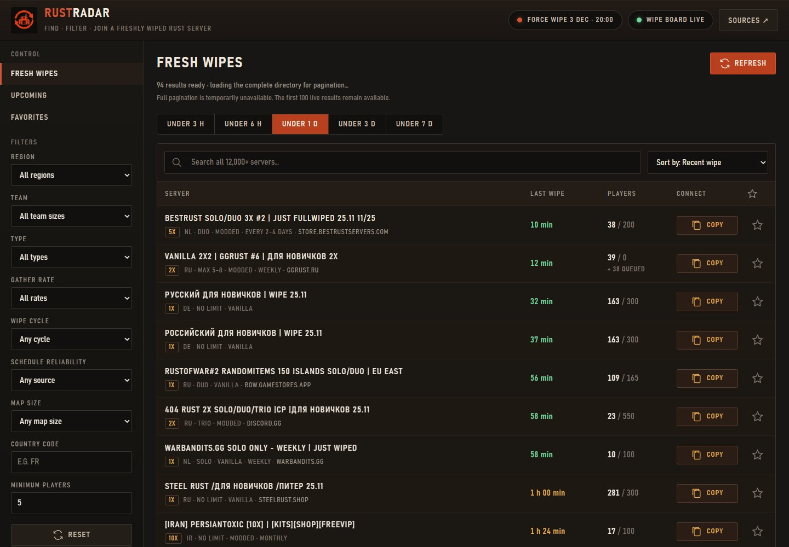
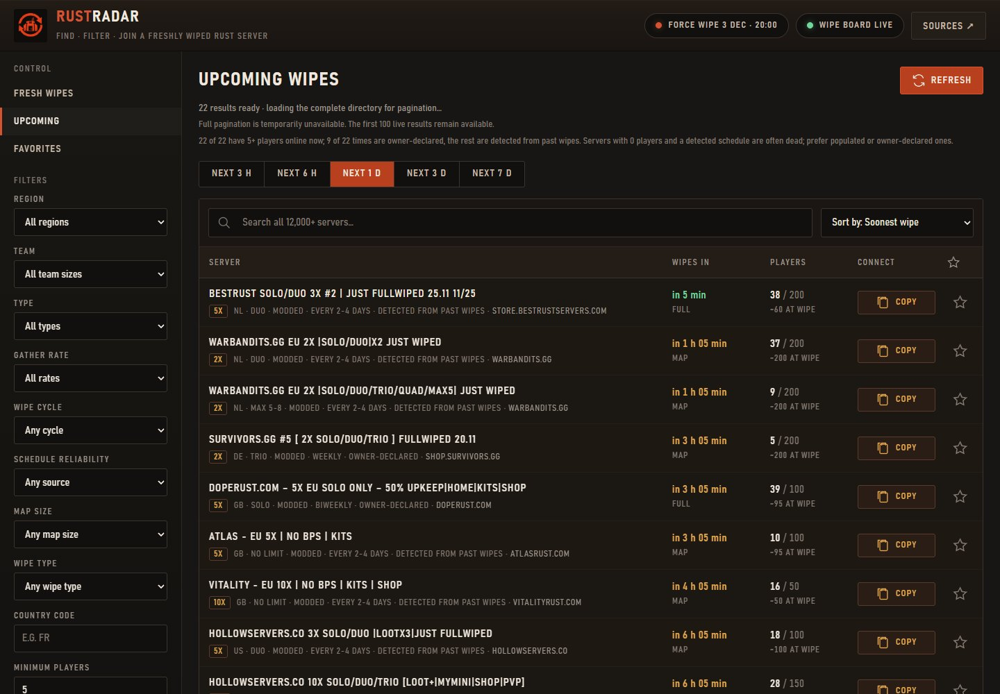

# RustRadar

Find Rust servers that recently wiped or are scheduled to wipe soon. Compare servers by region, team size, gather rate, and player count, then copy a connection command for the in-game F1 console.

**[Open RustRadar in your browser](https://la-dosette.github.io/RustRadar/)** · No account required to browse servers or save favorites on this device.

## Fresh wipes

Browse recent wipes, narrow the list with filters, and sort by wipe time, population, queue, rank, or map size.



## Upcoming wipes

See when servers are due to wipe and whether the schedule comes from the server owner or an estimate based on past wipes. Open a server's details to see its map, population, connection options, and wipe timeline.



## Favorites

Select the star next to a server to save it in this browser. Open **Favorites** to find saved servers again.

## Run locally

Requires Node.js 22 or later and npm.

```sh
git clone https://github.com/La-Dosette/RustRadar.git
cd RustRadar
npm ci
npm run dev
```

Open [http://localhost:5173](http://localhost:5173). For production, run `npm run build` and serve `dist/` as a static site, or run `npm start` to serve it with the Node API relay. To deploy on GitHub Pages, select **GitHub Actions** as the Pages source. The included workflow builds and deploys pushes to `main`.

## Data source

Server listings and wipe schedules come from the [Wipe Board API](https://wipeboard.net/api) under [CC BY 4.0](https://creativecommons.org/licenses/by/4.0/). Upcoming times may change, especially when estimated from previous wipes. If the full directory is unavailable, wipe feeds can still show live results with limited pagination.
